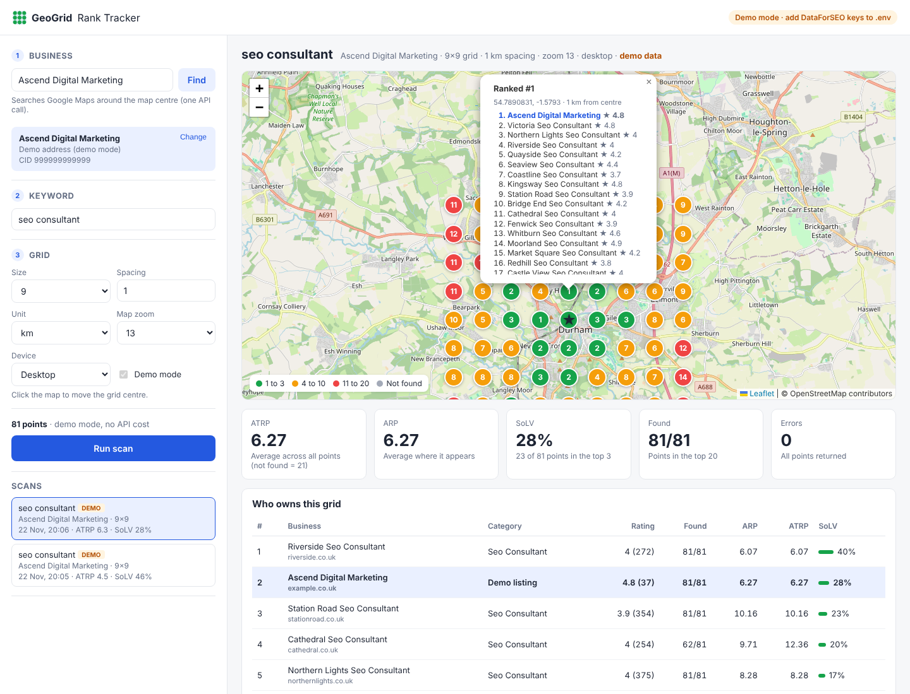

# GeoGrid Rank Tracker

A Local Falcon style grid rank tracker built on the DataForSEO Google Maps SERP API. Phase 1 of an AI Overviews grid tracker (see [PLAN.md](PLAN.md)).



## Run it

```bash
cp .env.example .env      # add your DataForSEO login and password
npm start                 # http://127.0.0.1:4321
npm test
```

No dependencies to install: Node 20+ only. Without credentials it runs in demo mode with simulated results.

## Using it

1. **Business**: search the name and town, pick the listing (locks its Google CID)
2. **Keyword**: e.g. `seo consultant`
3. **Grid**: size (3 to 15), spacing (km or miles), map zoom, device. Click the map to move the centre
4. **Run scan**: the cost estimate shows before it runs (Live mode is $0.002 per point)

Click any pin to see the top 20 from that spot.

## How it works

| File | Job |
|---|---|
| `lib/grid.js` | Builds the N x N grid of coordinates |
| `lib/engines/maps.js` | One Maps SERP per point (`location_coordinate: lat,lng,zoom`), matches the target by CID |
| `lib/engines/index.js` | Engine registry; the AI Overviews engine plugs in here |
| `lib/scanner.js` | Runs points 5 at a time, saves progress, scores the result |
| `lib/metrics.js` | ARP, ATRP, SoLV, competitor table |
| `lib/store.js` | One JSON file per scan in `data/scans` |
| `public/` | Light-mode UI (Leaflet + OpenStreetMap) |

## Metrics

- **ARP**: average rank where the business appears
- **ATRP**: average rank across every point, not found counted as 21
- **SoLV**: share of points where it is in the top 3
